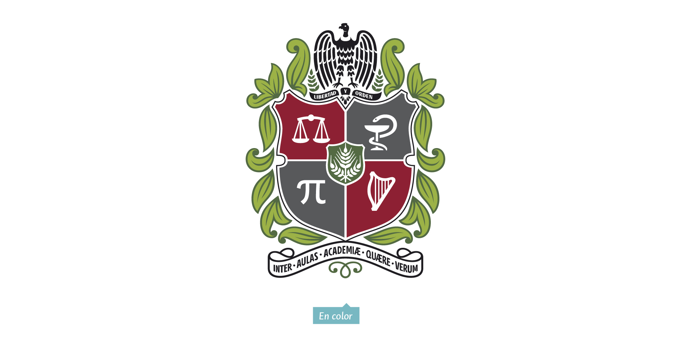

  

<h1 align="center">Universidad Nacional de Colombia</h1>
<h3 align="center">Sede Medellín</h3>

## Programación Orientada a Objetos

**Estudiante:** Laura Camila Rios Quintero  
**Profesor:** Walter Hugo Arboleda Mazo

---

## Actividades

| Actividad | Descripción |
|-----------|-------------|
| Actividad 1 | Ejercicios básicos con clases en Python (Familia, Seguimiento, Empleado, Numero, Circulo) |
| Actividad 2 | Clases Persona, Planeta, Automóvil, Figuras geométricas y Cuenta bancaria |
